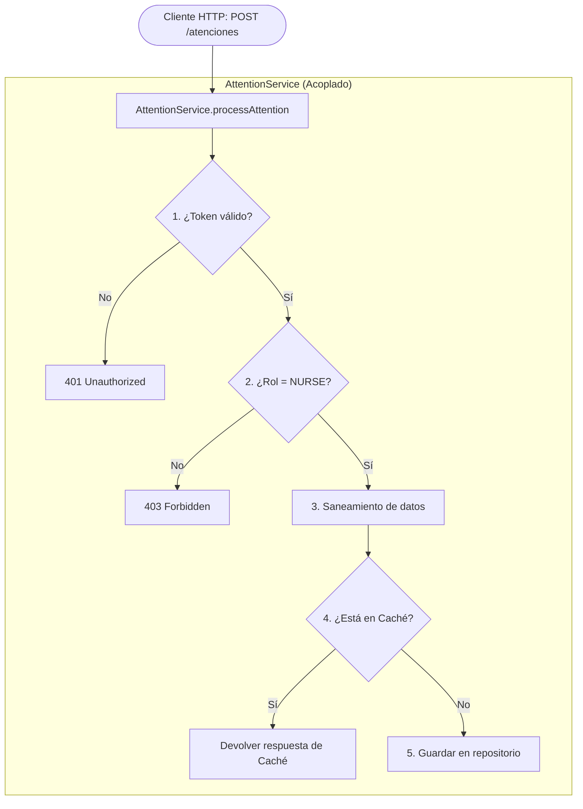
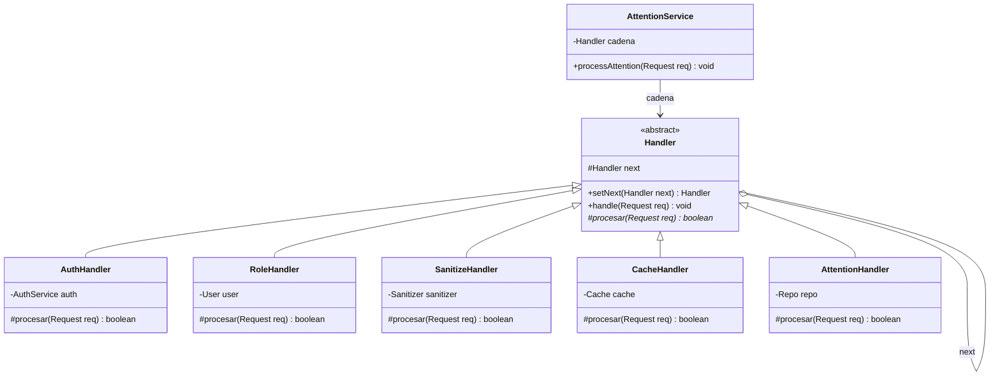
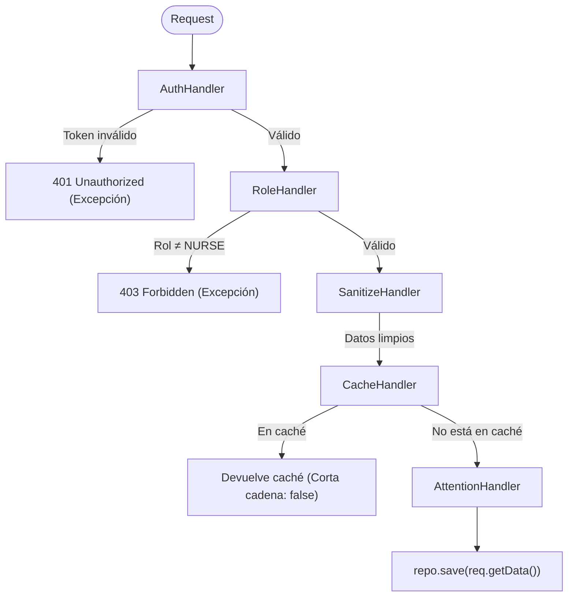

# Chain of Responsibility - Antes y Después

Ejercicio comparativo del patrón de diseño de comportamiento **Chain of Responsibility** (Cadena de Responsabilidad) aplicado a un **sistema empresarial y de salud con múltiples capas de seguridad**.

El objetivo es ver el mismo problema resuelto de dos formas: primero con código acoplado (`antes`) donde todas las reglas viven en un único método con bloques `if/else`, y luego aplicando el patrón (`despues`) desacoplando cada regla en un eslabón independiente e intercambiable.

---

## Estructura del Proyecto

```
chain-of-responsability/
├── antes/
│   ├── AntesMain.java                      (Punto de entrada: demuestra el flujo antes)
│   ├── domain/
│   │   ├── Request.java                    (Solicitud HTTP: token, data, user, respuesta)
│   │   └── User.java                       (Usuario y roles del sistema)
│   ├── exception/
│   │   ├── ForbiddenException.java         (Error HTTP 403: permisos insuficientes)
│   │   └── UnauthorizedException.java      (Error HTTP 401: token inválido/ausente)
│   └── service/
│       ├── AttentionService.java           (Servicio monolítico acoplado con if/else)
│       ├── AuthService.java                (Verificación de token)
│       ├── Cache.java                      (Almacenamiento en caché)
│       ├── Repo.java                       (Persistencia de atenciones)
│       └── Sanitizer.java                  (Limpieza de datos y etiquetas)
├── despues/
│   ├── DespuesMain.java                    (Punto de entrada: demuestra la cadena)
│   ├── domain/
│   │   ├── Request.java                    (Solicitud HTTP compartida)
│   │   └── User.java                       (Usuario del sistema)
│   ├── exception/
│   │   ├── ForbiddenException.java         (HTTP 403)
│   │   └── UnauthorizedException.java      (HTTP 401)
│   ├── handler/
│   │   ├── Handler.java                    (Clase base abstracta con next y handle)
│   │   ├── AuthHandler.java                (Eslabón 1: valida token -> 401)
│   │   ├── RoleHandler.java                (Eslabón 2: valida rol NURSE -> 403)
│   │   ├── SanitizeHandler.java            (Eslabón 3: limpia y sanea req.data)
│   │   ├── CacheHandler.java               (Eslabón 4: respuesta en caché -> corta cadena)
│   │   └── AttentionHandler.java           (Eslabón 5: persiste en BD -> fin de cadena)
│   └── service/
│       ├── AttentionService.java           (Servicio desacoplado: solo delega a la cadena)
│       ├── AuthService.java
│       ├── Cache.java
│       ├── Repo.java
│       └── Sanitizer.java
└── README.md
```

---

## Diapositiva 1: Contexto y problemática (antes del patrón)

### Título: Chain of Responsibility: el problema

**Contexto:**
- Sistema empresarial y de salud con múltiples capas de seguridad.
- Las solicitudes HTTP (registrar atención, procesar datos sensibles) deben pasar por varias validaciones.
- Todo se mezcla en un único servicio con bloques `if/else`.
- **Problemas principales:** acoplamiento rígido, violación del principio Open/Closed (OCP) y baja reutilización de las validaciones en otros flujos de la aplicación.

### Diagrama del flujo monolítico

#### Diagrama de bloques (ASCII)
```
 Cliente HTTP
      │  POST /atenciones  (token, rol, datos)
      ▼
┌──────────────────────────────────────────────┐
│             AttentionService                 │
├──────────────────────────────────────────────┤
│  1. ¿Token válido?        no → 401           │
│  2. ¿Rol = NURSE?         no → 403           │
│  3. Sanear datos                             │
│  4. ¿Resultado en caché?  sí → devolver      │
│  5. Guardar en repositorio                   │
└──────────────────────────────────────────────┘

  Todas las reglas viven en el mismo método.
  Agregar una regla = modificar la clase existente.
```

#### Diagrama de flujo (Mermaid)


---

## Diapositiva 2: Código del problema (antes)

### Título: Código antes del patrón

```java
public class AttentionService {

    public void processAttention(Request req) {
        // 1. Validación de token (acoplado)
        if (req.getToken() == null || !auth.verify(req.getToken())) {
            throw new UnauthorizedException();
        }

        // 2. Validación de rol (acoplado)
        if (!user.hasRole("NURSE")) {
            throw new ForbiddenException();
        }

        // 3. Saneamiento
        String cleanData = sanitizer.clean(req.getData());

        // 4. Revisión de caché (acoplado)
        if (cache.contains(cleanData)) {
            req.setRespuesta(cache.get(cleanData));
            return;
        }

        // 5. Lógica principal
        repo.save(cleanData);
    }
}
```

> **Pie de diapositiva:** El método conoce todas las reglas, cada cambio obliga a modificarlo y las validaciones no se pueden reutilizar por separado.

---

## Diapositiva 3: Diagrama con el patrón aplicado

### Título: Estructura de la solución

#### Diagrama de clases

##### ASCII
```
            ┌──────────────────────────────────┐
            │       <<abstract>> Handler       │
            ├──────────────────────────────────┤
            │ # next : Handler                 │
            ├──────────────────────────────────┤
            │ + setNext(next : Handler)        │
            │ + handle(req : Request)          │
            │ # procesar(req) : boolean  «abs» │
            └────────────────▲─────────────────┘
                             │ hereda
     ┌──────────┬────────────┼────────────┬──────────────┬──────────────────┐
     │          │            │            │              │                  │
 AuthHandler RoleHandler SanitizeHandler CacheHandler AttentionHandler
```

##### Mermaid


#### Diagrama de flujo de la cadena

##### ASCII
```
 Request
    │
    ▼
┌─────────────┐  token inválido   ┌───────────────┐
│ AuthHandler │ ────────────────▶ │  401 Unauth.  │
└──────┬──────┘                   └───────────────┘
       │ válido
       ▼
┌──────────────┐  rol ≠ NURSE     ┌───────────────┐
│ RoleHandler  │ ────────────────▶ │ 403 Forbidden │
└──────┬───────┘                  └───────────────┘
       │ válido
       ▼
┌────────────────┐
│ SanitizeHandler│  limpia los datos
└──────┬─────────┘
       │
       ▼
┌──────────────┐  en caché        ┌────────────────┐
│ CacheHandler │ ────────────────▶ │ devuelve caché │  (la cadena se corta)
└──────┬───────┘                  └────────────────┘
       │ no está en caché
       ▼
┌──────────────────┐
│ AttentionHandler │  repo.save(...)  (último eslabón)
└──────────────────┘
```

##### Mermaid


> **Pie de diapositiva:** Cada manejador decide si rechaza la solicitud, si la corta (como la caché devolviendo `false`) o si la pasa al siguiente eslabón.

---

## Diapositiva 4: Código del problema con el patrón (después)

### Título: Código después del patrón

#### 1. Clase Base (`Handler`)

```java
public abstract class Handler {

    protected Handler next;

    public Handler setNext(Handler next) {
        this.next = next;
        return next;   // permite encadenar: a.setNext(b).setNext(c)
    }

    public void handle(Request req) {
        if (procesar(req) && next != null) {
            next.handle(req);
        }
    }

    // true = continúa la cadena; false = la corta aquí
    protected abstract boolean procesar(Request req);
}
```

#### 2. Manejadores Concretos

```java
public class AuthHandler extends Handler {

    private final AuthService auth;

    public AuthHandler(AuthService auth) {
        this.auth = auth;
    }

    @Override
    protected boolean procesar(Request req) {
        if (req.getToken() == null || !auth.verify(req.getToken())) {
            throw new UnauthorizedException();
        }
        return true;
    }
}

public class RoleHandler extends Handler {

    private final User user;

    public RoleHandler(User user) {
        this.user = user;
    }

    @Override
    protected boolean procesar(Request req) {
        User targetUser = (req.getUser() != null) ? req.getUser() : this.user;
        if (targetUser == null || !targetUser.hasRole("NURSE")) {
            throw new ForbiddenException();
        }
        return true;
    }
}

public class SanitizeHandler extends Handler {

    private final Sanitizer sanitizer;

    public SanitizeHandler(Sanitizer sanitizer) {
        this.sanitizer = sanitizer;
    }

    @Override
    protected boolean procesar(Request req) {
        String cleanData = sanitizer.clean(req.getData());
        req.setData(cleanData);
        return true;
    }
}

public class CacheHandler extends Handler {

    private final Cache cache;

    public CacheHandler(Cache cache) {
        this.cache = cache;
    }

    @Override
    protected boolean procesar(Request req) {
        if (cache.contains(req.getData())) {
            req.setRespuesta(cache.get(req.getData()));
            return false;   // corta la cadena
        }
        return true;
    }
}

public class AttentionHandler extends Handler {

    private final Repo repo;

    public AttentionHandler(Repo repo) {
        this.repo = repo;
    }

    @Override
    protected boolean procesar(Request req) {
        repo.save(req.getData());
        req.setRespuesta("Atención registrada con éxito en repositorio: " + req.getData());
        return true;
    }
}
```

#### 3. Servicio Refactorizado

```java
public class AttentionService {

    private final Handler cadena;

    public AttentionService(AuthService auth, User user, Sanitizer sanitizer,
                            Cache cache, Repo repo) {
        Handler primero = new AuthHandler(auth);
        primero.setNext(new RoleHandler(user))
               .setNext(new SanitizeHandler(sanitizer))
               .setNext(new CacheHandler(cache))
               .setNext(new AttentionHandler(repo));
        this.cadena = primero;
    }

    public void processAttention(Request req) {
        cadena.handle(req);
    }
}
```

> **Pie de diapositiva:** `AttentionService` ya no conoce las reglas. Para añadir un control de IP, rate limiting o auditoría, basta con crear un manejador nuevo e insertarlo en la cadena sin modificar los existentes.

---

## Cómo Extender (Demostración del Principio Open/Closed - OCP)

Para añadir una nueva regla (por ejemplo, registro de auditoría o limitador de tasa de peticiones):

1. **Crear una nueva clase** que herede de `Handler`:
   ```java
   public class AuditLogHandler extends Handler {
       @Override
       protected boolean procesar(Request req) {
           System.out.println("[Auditoría] Registro de evento: " + req.getData());
           return true; // continúa la cadena
       }
   }
   ```
2. **Insertarla en el orden deseado** al ensamblar la cadena:
   ```java
   primero.setNext(new RoleHandler(user))
          .setNext(new SanitizeHandler(sanitizer))
          .setNext(new AuditLogHandler()) // Nuevo eslabón inyectado
          .setNext(new CacheHandler(cache))
          .setNext(new AttentionHandler(repo));
   ```
3. **No se modifica ninguna línea** de `AuthHandler`, `RoleHandler`, `SanitizeHandler`, `CacheHandler` ni `AttentionHandler`.

---

## Compilar y Ejecutar

Ambas versiones se compilan en carpetas de salida independientes (`out/antes` y `out/despues`):

### Versión ANTES (Monolito acoplado)
```powershell
javac -encoding UTF-8 -d out/antes (Get-ChildItem antes -Recurse -Filter *.java | ForEach-Object FullName)
java -cp out/antes antes.AntesMain
```

### Versión DESPUÉS (Chain of Responsibility)
```powershell
javac -encoding UTF-8 -d out/despues (Get-ChildItem despues -Recurse -Filter *.java | ForEach-Object FullName)
java -cp out/despues despues.DespuesMain
```

---

## Salida de Ejecución

### Salida de `AntesMain`
```
============================================================
   ANTES DEL PATRÓN: Monolito en AttentionService
============================================================

--- Caso 1: Solicitud válida (Procesamiento completo) ---
    [Repo] Guardado en base de datos: "Registro de curación de herida profunda"
  Resultado: OK
  Datos saneados: Registro de curación de herida profunda
  Respuesta: Atención registrada con éxito en repositorio: Registro de curación de herida profunda

--- Caso 2: Solicitud en Caché (Corta flujo sin ir a BD) ---
  Resultado: OK (Atendida por caché)
  Respuesta: Respuesta desde CACHÉ (resultado previo)

--- Caso 3: Token inválido / ausente ---
  Excepción capturada esperada: 401 Unauthorized: Token de autenticación inválido o ausente.

--- Caso 4: Rol no autorizado (PATIENT en vez de NURSE) ---
  Excepción capturada esperada: 403 Forbidden: Permisos insuficientes. Se requiere el rol 'NURSE'.

============================================================
```

### Salida de `DespuesMain`
```
============================================================
   DESPUÉS DEL PATRÓN: Cadena de Responsabilidad (CoR)
============================================================

--- Caso 1: Solicitud válida (Procesamiento completo por la cadena) ---
    [Repo] Guardado en base de datos: "Registro de curación de herida profunda"
  Resultado: OK
  Datos saneados: Registro de curación de herida profunda
  Respuesta: Atención registrada con éxito en repositorio: Registro de curación de herida profunda

--- Caso 2: Solicitud en Caché (CacheHandler corta la cadena) ---
  Resultado: OK (Atendida por caché)
  Respuesta: Respuesta desde CACHÉ (resultado previo)

--- Caso 3: Token inválido / ausente (Rechazado en AuthHandler) ---
  Excepción capturada esperada: 401 Unauthorized: Token de autenticación inválido o ausente.

--- Caso 4: Rol no autorizado (Rechazado en RoleHandler) ---
  Excepción capturada esperada: 403 Forbidden: Permisos insuficientes. Se requiere el rol 'NURSE'.

--- Caso 5: Demostración OCP (Nuevo eslabón AuditLogHandler insertado) ---
  [AuditLogHandler] Registrando evento de auditoría para: Aplicación de vacuna contra influenza
    [Repo] Guardado en base de datos: "Aplicación de vacuna contra influenza"
  Resultado: OK (Procesado con eslabón nuevo de auditoría)

============================================================
```
